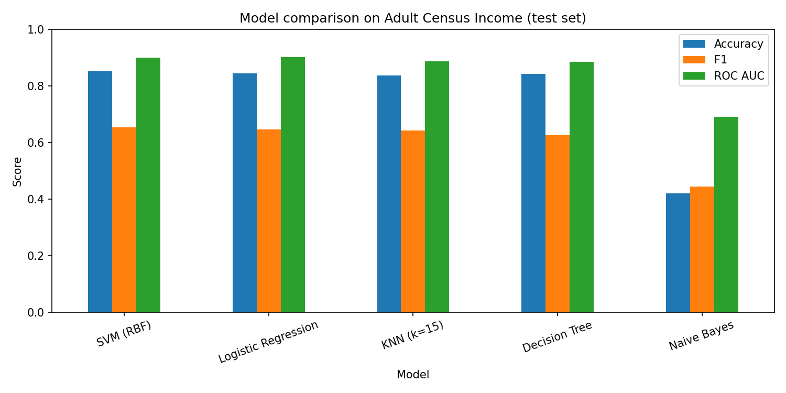

# Comparing 5 Supervised Learning Algorithms

A fair comparison of five classifiers on the **Adult Census Income** dataset (predict whether a person earns >$50K).

## Setup
- Dataset: Adult (OpenML), subsampled to 15,000 rows so SVM/KNN run quickly. Mixed numeric + categorical features, missing values, ~24% positive class.
- Same stratified 80/20 split (`random_state=42`) and same preprocessing for every model.
- Preprocessing (fit on train only, via `Pipeline`): median imputation + `StandardScaler` for numeric features, most-frequent imputation + `OneHotEncoder` for categorical features.
- Models: Logistic Regression, Decision Tree (max_depth=8), KNN (k=15), SVM (RBF), Gaussian Naive Bayes.
- Metrics: accuracy, precision, recall, F1, ROC AUC. Ranking is by F1, because the classes are imbalanced and accuracy alone can mislead.

## How to run
```
pip install -r requirements.txt
python compare_models.py
```

## Results (paste YOUR output from results.csv)
Rank,Model,Accuracy,Precision,Recall,F1,ROC AUC
1,SVM (RBF),0.8513,0.7403,0.5836,0.6526,0.9001
2,Logistic Regression,0.8443,0.7088,0.5933,0.6459,0.9024
3,KNN (k=15),0.8377,0.6796,0.6086,0.6422,0.8867
4,Decision Tree,0.8417,0.7197,0.5543,0.6263,0.885
5,Naive Bayes,0.4193,0.2881,0.9694,0.4442,0.6906




## Analysis (write in your own words, based on YOUR results)

Best model: SVM (RBF). SVM ranked first on F1 (0.653) and accuracy (0.851). A likely reason is that income depends on interactions between features (for example, age, education and hours worked together) rather than on each feature separately. The RBF kernel can capture non-linear boundaries, and the standardized numeric features and one-hot categorical features suit it well. However, the margin over Logistic Regression is small (F1 0.646, and Logistic actually had the higher ROC AUC), which suggests the boundary is mostly close to linear and the gap may be within noise on this test set.

Worst model: Naive Bayes. Gaussian Naive Bayes did far worse (accuracy 0.419, F1 0.444), and its accuracy was even below the majority-class baseline of about 76%. It predicted the positive class far too often (recall 0.97, precision 0.29). A likely cause is that its assumptions don't fit this data: it treats features as independent and Gaussian, but one-hot encoded columns are binary, not Gaussian, and many features are strongly related (such as education and education-num, or marital status and relationship). Correlated features get counted several times, which makes the model overconfident about the positive class.

Others. The Decision Tree had the lowest recall of the top four (0.554). A single depth-limited tree can miss patterns and is sensitive to its settings. KNN did slightly worse than SVM, probably because distances are less informative in the high-dimensional space created by one-hot encoding. All models were limited by class imbalance, shown by recall staying near 0.55 to 0.61 even when accuracy looked decent.